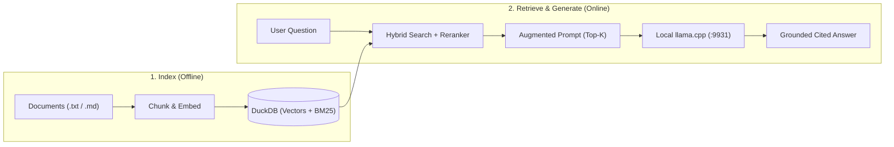

<div align="center">
  
  <h1>🦉 RAG Tutor</h1>
  <p><strong>An Interactive RAG Curriculum &amp; Playground</strong></p>
  <p>Python · Marimo · Astral <code>uv</code> · DuckDB · <code>llama.cpp</code> (<code>Llama.app</code>)</p>
</div>

> [!IMPORTANT]
> **Local Mode with `llama.cpp` Is Preferred**: Run these notebooks locally (`uv run marimo edit ...`) with a local **`llama.cpp`** server (`Llama.app` or `llama-server` on `http://localhost:9931`) for live LLM answers; `molab` badges are read-only previews.

---

## ✨ Overview

**RAG Tutor** is a hands-on curriculum for learning how **Retrieval-Augmented Generation (RAG)** works—starting from a 50-line pure-Python prototype ([inspired by Xuan-Son Nguyen's guide](https://huggingface.co/blog/ngxson/make-your-own-rag)) and progressing to a modular, production-style RAG studio.

- **Start from First Principles**: See why LLMs hallucinate, explore embeddings and cosine similarity visually, and build RAG in plain Python with no framework magic.
- **Store & Search in DuckDB**: Experiment with document chunking, `FLOAT[128]` vector search, Okapi BM25 keyword search, and SQL metadata filtering.
- **Add Production Techniques**: Compare Hybrid Search (RRF vs. Convex fusion), Cross-Encoder reranking, Agentic multi-hop verification, GraphRAG, and HyDE / Multi-Query expansion.
- **Local-First & Inspectable**: Powered by DuckDB, Marimo, and local `llama.cpp` inference—every score, rank shift, prompt, and citation trace is visible in the UI.

---

## ⚡ Quickstart & Prerequisites

- **Prerequisites**: [`git`](https://git-scm.com/), **Python `>=3.15`**, [`uv`](https://docs.astral.sh/uv/) (installs `duckdb` & `marimo`), and a local [`llama.cpp`](https://github.com/ggml-org/llama.cpp) server on `http://localhost:9931` *(optional offline fallback is built in, but `llama.cpp` is preferred)*:
  - **macOS**: Launch [**`Llama.app`**](https://github.com/ggml-org/Llama-macOS) with a GGUF chat model (e.g. `ggml-org/gemma-4-E4B-it-GGUF:Q8_0`).
  - **CLI / Linux / Windows**: `llama-server -hf ggml-org/gemma-4-E4B-it-GGUF:Q8_0 --host 127.0.0.1 --port 9931`

```bash
git clone https://github.com/NewGuy012/rag-tutor.git && cd rag-tutor
uv sync
uv run marimo edit notebooks/01_rag_fundamentals.py
```

- **Other commands**: `uv run marimo run notebooks/04_final_project_studio.py` (app mode) · `uv run python -m unittest discover -s tests -v` (tests) · see **Notebooks** below for `02`–`05`.

---

## 🏗️ How RAG Works at a Glance



---

## 🗺️ Notebooks

| Notebook | Read-Only Preview | Focus |
| :--- | :--- | :--- |
| **[`01_rag_fundamentals.py`](notebooks/01_rag_fundamentals.py)** | [](https://molab.marimo.io/github/NewGuy012/rag-tutor/blob/master/notebooks/01_rag_fundamentals.py) | **Fundamentals**: Hallucinations vs. RAG, 2D vector compass, PCA map, 128-D barcode, and 50-line scratch RAG. |
| **[`02_chunking_and_duckdb.py`](notebooks/02_chunking_and_duckdb.py)** | [](https://molab.marimo.io/github/NewGuy012/rag-tutor/blob/master/notebooks/02_chunking_and_duckdb.py) | **Chunking & DuckDB**: Chunk boundaries/overlap minimap, `FLOAT[128]` indexing, and read-only SQL playground. |
| **[`03_advanced_rag.py`](notebooks/03_advanced_rag.py)** | [](https://molab.marimo.io/github/NewGuy012/rag-tutor/blob/master/notebooks/03_advanced_rag.py) | **Production RAG**: Hybrid search (BM25 + RRF), Cross-Encoder reranking, and Agentic verification. |
| **[`04_final_project_studio.py`](notebooks/04_final_project_studio.py)** | [](https://molab.marimo.io/github/NewGuy012/rag-tutor/blob/master/notebooks/04_final_project_studio.py) | **Capstone Studio**: Bring your own Markdown docs, toggle pipeline stages live, and compare Basic vs. Production in an A/B Arena. |
| **[`05_advanced_modular_graph_rag.py`](notebooks/05_advanced_modular_graph_rag.py)** | [](https://molab.marimo.io/github/NewGuy012/rag-tutor/blob/master/notebooks/05_advanced_modular_graph_rag.py) | **Graph & Modular RAG**: Dense + Sparse + Knowledge Graph + SQL filters, RRF vs. Convex fusion, HyDE, and Multi-Query. |

> 💡 **About `molab` previews**: Badges above show static pre-rendered outputs from [`notebooks/__marimo__/session/`](notebooks/__marimo__/session/). Run locally via Quickstart above for live LLM inference and interactive editing. After editing notebooks, refresh snapshots with `uv run marimo export session notebooks/`.

📖 **Companion Textbook**: See [**`docs/RAG_REFERENCE_GUIDE.md`**](docs/RAG_REFERENCE_GUIDE.md) for the math, SQL cheat sheets, and architecture deep dives.

---

## 📁 Project Structure

```text
rag-tutor/
├── pyproject.toml                 # Astral uv project & dependencies
├── README.md                      # Quickstart & curriculum overview
├── assets/
│   └── logo.png                   # RAG Tutor project logo
├── docs/
│   └── RAG_REFERENCE_GUIDE.md     # Beginner-to-Production Markdown Reference Guide
├── data/
│   ├── ev-facts.txt               # 1-line-per-fact EV dataset for Notebook 1
│   └── sample_docs/               # Multi-document Markdown corpus for Notebooks 2–5
├── src/
│   └── rag_tutor/
│       ├── llm_backend.py         # llama.cpp / Llama.app client (:9931/v1) + local embeddings
│       ├── scratch_rag.py         # Pure-Python cosine similarity & SimpleVectorDB
│       ├── chunker.py             # Fixed-window, Markdown chunkers & corpus loader
│       ├── duckdb_store.py        # DuckDB FLOAT[128] vector + Okapi BM25 + SQL filters
│       ├── hybrid_search.py       # RRF-K60 & Min-Max Convex Combination fusion engine
│       ├── reranker.py            # Stage-2 Cross-Encoder reranker
│       ├── agentic_rag.py         # Query planner, iterative retriever & verifier
│       ├── modular_graph_rag.py   # KnowledgeGraphStore, HyDE/Multi-Query & Modular RAG
│       └── visualizations.py      # Interactive SVG, PCA map, heatmap & Mermaid builders
├── notebooks/
│   ├── 01_rag_fundamentals.py
│   ├── 02_chunking_and_duckdb.py
│   ├── 03_advanced_rag.py
│   ├── 04_final_project_studio.py
│   └── 05_advanced_modular_graph_rag.py
└── tests/
    └── test_rag_tutor.py
```

---

## 📚 References & Inspiration

1. [Code a simple RAG from scratch — Xuan-Son Nguyen (`ngxson`), Hugging Face Blog](https://huggingface.co/blog/ngxson/make-your-own-rag)
2. [LLM RAG Tutorial — LaunchDarkly](https://launchdarkly.com/blog/llm-rag-tutorial/)
3. [RAG Solution Design and Evaluation Guide — Microsoft Azure Architecture Center](https://learn.microsoft.com/en-us/azure/architecture/ai-ml/guide/rag/rag-solution-design-and-evaluation-guide)
4. [Building Production RAG Systems from Zero to Hero — DEV Community](https://dev.to/gautamvhavle/building-production-rag-systems-from-zero-to-hero-2f1i)
5. [`ggml-org/Llama-macOS` — Native macOS Local LLM App (`llama.cpp`)](https://github.com/ggml-org/Llama-macOS)
6. [`ggml-org/llama.cpp` — LLM Inference in C/C++](https://github.com/ggml-org/llama.cpp)
