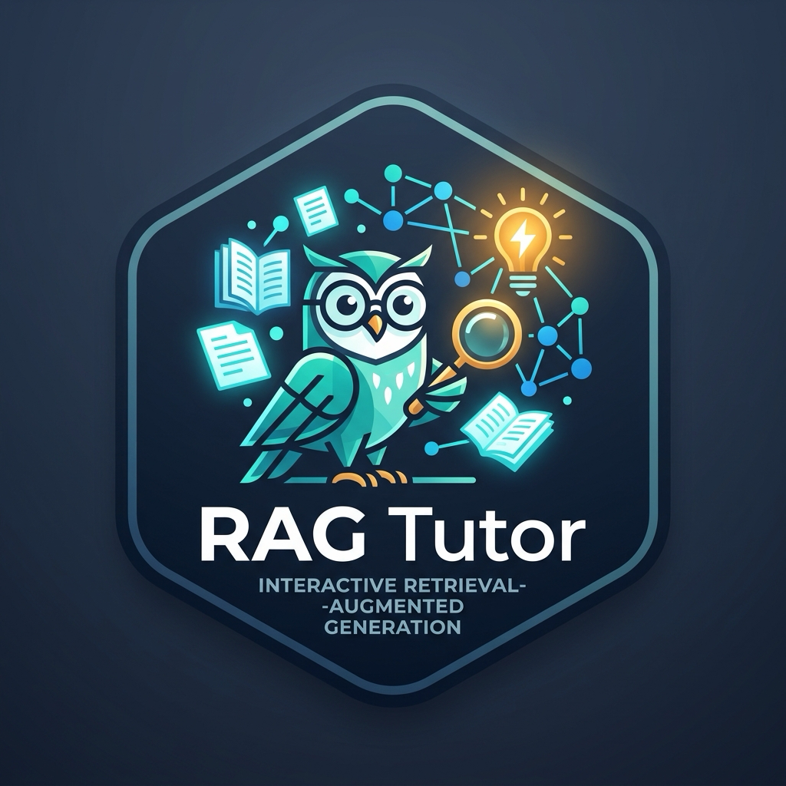
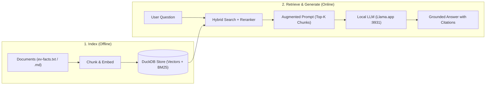
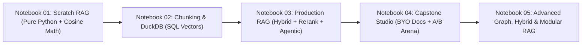

<div align="center">
  
  <h1>🦉 RAG Tutor</h1>
  <p><strong>An Interactive, Beginner-Friendly Retrieval-Augmented Generation (RAG) Curriculum & Playground</strong></p>
  <p>Built with <strong>Python</strong> · <strong>Marimo</strong> · <strong>Astral <code>uv</code></strong> · <strong>DuckDB</strong> · <strong>Llama-macOS (<code>Llama.app</code>)</strong></p>
</div>

---

## ✨ Overview

**RAG Tutor** is an interactive educational toolkit that teaches you **how and why Retrieval-Augmented Generation (RAG) systems work**—starting from a 50-line pure-Python implementation ([inspired by Xuan-Son Nguyen's Hugging Face guide](https://huggingface.co/blog/ngxson/make-your-own-rag)) and building step-by-step toward a customizable **Capstone RAG Studio** with production-grade upgrades:

- **Pure-Python Fundamentals**: Understand why LLMs hallucinate, explore 2D vectors and cosine similarity interactively, and build a working RAG system on `ev-facts.txt` with zero black-box frameworks.
- **Chunking & Embedded DuckDB Vector Store**: Visually experiment with document chunking and sliding overlap, then graduate from Python lists to persistent `FLOAT[N]` vector & full-text tables in **DuckDB**.
- **Common Improvements for Production**:
  - **Hybrid Search**: Blend lexical keyword search (**Okapi BM25**) with semantic vector search using **Reciprocal Rank Fusion (`RRF-K60`)**.
  - **Cross-Encoder Reranking**: Implement two-stage retrieval (`STAGE2-RERANK-15to3`) to re-score candidate pairs and filter out noisy distractors.
  - **Agentic RAG**: Decompose multi-hop questions into sub-queries, perform iterative lookups with sufficiency checks, and audit responses for faithfulness.
- **Advanced Graph, Hybrid & Modular RAG**: Combine **Dense + Sparse** search, **Vector + Knowledge Graph (`GraphRAG`)** traversal, and **Vector + SQL/Metadata Filtering**, compare **RRF vs. Convex Combination** score fusion, apply **HyDE / Multi-Query** expansion, and explore hybrid vector databases.
- **Native macOS Local LLM (`Llama.app`)**: Connects automatically to [`ggml-org/Llama-macOS`](https://github.com/ggml-org/Llama-macOS) on `http://localhost:9931/v1` (with an automatic offline fallback so every notebook runs out of the box).

---

## 🏗️ How RAG Works at a Glance



```text
  [ User Question ] ──► (1) Embed & Search ──► [ DuckDB: Vector + BM25 ]
                                                         │
                                              Top-K Relevant Chunks
                                                         ▼
  [ Cited Answer ]  ◄── (3) Local Llama.app ◄── (2) Augment System Prompt
```

---

## 🗺️ Multi-Notebook Learning Path



| Notebook | Preview | Topic | What You'll Build & Explore |
| :--- | :--- | :--- | :--- |
| **[`notebooks/01_rag_fundamentals.py`](notebooks/01_rag_fundamentals.py)** | [](https://molab.marimo.io/github/NewGuy012/rag-tutor/blob/master/notebooks/01_rag_fundamentals.py) | **Part 1: The Basic Hows & Whys** | Compare RAG vs. No-RAG hallucinations, drag 2D vectors on an **Interactive Vector Compass** (with projection arcs & Cosine vs. Dot vs. Euclidean gauges), explore a **2D PCA Embedding Space Map** with live query rays, and inspect a **128-D Embedding Barcode Heatmap**. |
| **[`notebooks/02_chunking_and_duckdb.py`](notebooks/02_chunking_and_duckdb.py)** | [](https://molab.marimo.io/github/NewGuy012/rag-tutor/blob/master/notebooks/02_chunking_and_duckdb.py) | **Part 2: Chunking & DuckDB Vectors** | Visualize section boundaries & sliding overlap on a **Document Chunking Timeline Minimap & Size Histogram**, index `FLOAT[128]` vectors into **DuckDB**, and run curated recipes in the **Interactive SQL Playground**. |
| **[`notebooks/03_advanced_rag.py`](notebooks/03_advanced_rag.py)** | [](https://molab.marimo.io/github/NewGuy012/rag-tutor/blob/master/notebooks/03_advanced_rag.py) | **Part 3: Production Improvements** | Tune **Hybrid Search** with a live **Stacked RRF Decomposition & Decay Curve**, trace **Stage-1 → Stage-2 Cross-Encoder Rank Slopegraphs** & **Token × Sentence Attention Matrices**, and watch a **Dynamic Mermaid Agentic Execution Graph** & **Claim Faithfulness Meter**. |
| **[`notebooks/04_final_project_studio.py`](notebooks/04_final_project_studio.py)** | [](https://molab.marimo.io/github/NewGuy012/rag-tutor/blob/master/notebooks/04_final_project_studio.py) | **Part 4: Capstone RAG Studio** | Bring your own Markdown documents, inspect custom chunk minimaps, watch the **Live Pipeline B Mermaid Architecture Diagram** rewire as you flip switches, and compare Basic vs. Production RAG in the **Visual A/B Arena**. |
| **[`notebooks/05_advanced_modular_graph_rag.py`](notebooks/05_advanced_modular_graph_rag.py)** | [](https://molab.marimo.io/github/NewGuy012/rag-tutor/blob/master/notebooks/05_advanced_modular_graph_rag.py) | **Part 5: Graph, Hybrid & Modular RAG** | Explore **Parallel Retrieval** (**Dense + Sparse**, **Vector + Knowledge Graph SVG Traversal**, **Vector + SQL Metadata Filters**), compare **RRF vs. Min-Max Convex Combination**, test **HyDE & Multi-Query Expansion**, and compare production vector DBs (Qdrant, Weaviate, Pinecone, Elastic). |

> 💡 **Previewing on `molab`**: Click any **Open in molab** badge above to preview the notebook with pre-rendered outputs from [`notebooks/__marimo__/session/`](notebooks/__marimo__/session/). To refresh snapshots locally after editing notebooks, run `uv run marimo export session notebooks/`.

📖 **Companion Textbook**: Read the standalone [**RAG Reference Guide (`docs/RAG_REFERENCE_GUIDE.md`)**](docs/RAG_REFERENCE_GUIDE.md) for mathematical intuition, SQL cheat sheets, architecture diagrams, and production design patterns.

---

## ⚡ Quickstart

### 1. Prerequisites
- **Python `>=3.15`**
- **[Astral `uv`](https://docs.astral.sh/uv/)** (installed at `/opt/homebrew/bin/uv`)
- **[DuckDB](https://duckdb.org/)** (only core runtime dependency; `marimo` is installed via the `dev` dependency group)
- **[`Llama.app` (`ggml-org/Llama-macOS`)](https://github.com/ggml-org/Llama-macOS)** installed in `/Applications/Llama.app` (runs local OpenAI-compatible server at `http://localhost:9931/v1`).
  - *Note: Even if `Llama.app` is not currently running, all five notebooks include a built-in deterministic fallback synthesizer and local embedding engine so you can run and explore every widget immediately!*

### 2. Install Environment with `uv`
```bash
uv sync
```
*(Use `uv sync --no-dev` if you only need the `rag_tutor` library + DuckDB without Marimo.)*

### 3. Launch the Interactive Marimo Notebooks

Open any notebook in interactive **edit mode** (where you can inspect and modify both code and UI widgets):

```bash
# Notebook 1: RAG Fundamentals & 50-Line Scratch RAG
uv run marimo edit notebooks/01_rag_fundamentals.py

# Notebook 2: Document Chunking Lab & DuckDB Vector Store
uv run marimo edit notebooks/02_chunking_and_duckdb.py

# Notebook 3: Hybrid Search, Cross-Encoder Reranking & Agentic RAG
uv run marimo edit notebooks/03_advanced_rag.py

# Notebook 4: Capstone Final Project — Bring-Your-Own-Docs RAG Studio
uv run marimo edit notebooks/04_final_project_studio.py

# Notebook 5: Advanced Graph, Hybrid & Modular RAG
uv run marimo edit notebooks/05_advanced_modular_graph_rag.py
```

Or launch the Capstone Studio as a clean **web app**:
```bash
uv run marimo run notebooks/04_final_project_studio.py
```

### 4. Run Unit Tests
```bash
uv run python -m unittest discover -s tests -v
```

---

## 📁 Project Structure

```text
rag-tutor/
├── pyproject.toml                 # Astral uv project & dependencies
├── README.md                      # Quickstart & curriculum overview
├── assets/
│   └── logo.png                   # RAG Tutor project logo
├── docs/
│   └── RAG_REFERENCE_GUIDE.md     # Beginner-to-Production Markdown Reference Guide
├── data/
│   ├── ev-facts.txt               # 1-line-per-fact EV dataset for Notebook 1
│   └── sample_docs/               # Multi-document Markdown corpus for Notebooks 2–5
├── src/
│   └── rag_tutor/
│       ├── llm_backend.py         # Llama.app client (:9931/v1) + local embeddings
│       ├── scratch_rag.py         # Pure-Python cosine similarity & SimpleVectorDB
│       ├── chunker.py             # Line, fixed-window & Markdown section chunkers
│       ├── duckdb_store.py        # DuckDB FLOAT[128] vector + Okapi BM25 + SQL filters
│       ├── hybrid_search.py       # RRF-K60 & Min-Max Convex Combination fusion engine
│       ├── reranker.py            # Stage-2 Cross-Encoder reranker
│       ├── agentic_rag.py         # Query planner, iterative retriever & verifier
│       ├── modular_graph_rag.py   # KnowledgeGraphStore, HyDE/Multi-Query & Modular RAG
│       └── visualizations.py      # Interactive SVG, PCA map, heatmap & Mermaid builders
├── notebooks/
│   ├── 01_rag_fundamentals.py
│   ├── 02_chunking_and_duckdb.py
│   ├── 03_advanced_rag.py
│   ├── 04_final_project_studio.py
│   └── 05_advanced_modular_graph_rag.py
└── tests/
    └── test_rag_tutor.py
```

---

## 📚 References & Inspiration

1. [Code a simple RAG from scratch — Xuan-Son Nguyen (`ngxson`), Hugging Face Blog](https://huggingface.co/blog/ngxson/make-your-own-rag)
2. [LLM RAG Tutorial — LaunchDarkly](https://launchdarkly.com/blog/llm-rag-tutorial/)
3. [RAG Solution Design and Evaluation Guide — Microsoft Azure Architecture Center](https://learn.microsoft.com/en-us/azure/architecture/ai-ml/guide/rag/rag-solution-design-and-evaluation-guide)
4. [Building Production RAG Systems from Zero to Hero — DEV Community](https://dev.to/gautamvhavle/building-production-rag-systems-from-zero-to-hero-2f1i)
5. [`ggml-org/Llama-macOS` — Native macOS Local LLM App](https://github.com/ggml-org/Llama-macOS)
