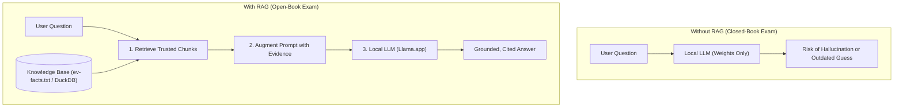
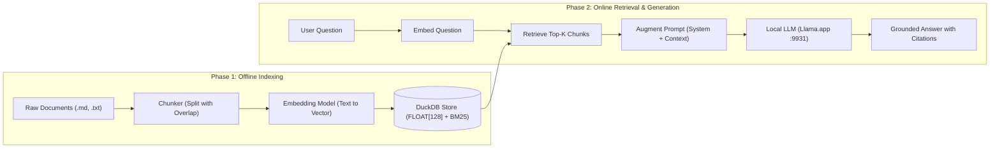
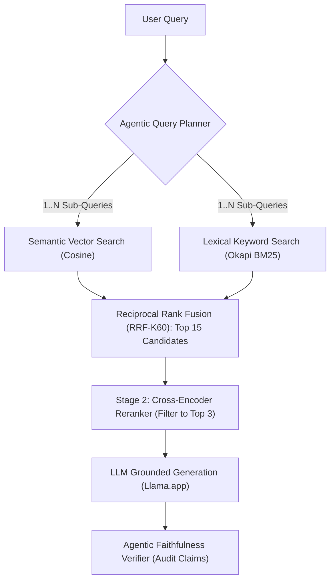
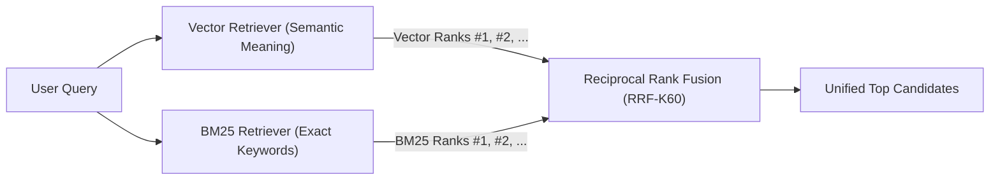
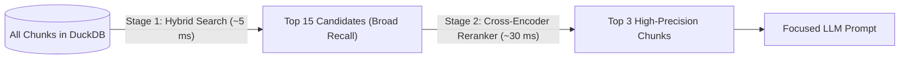
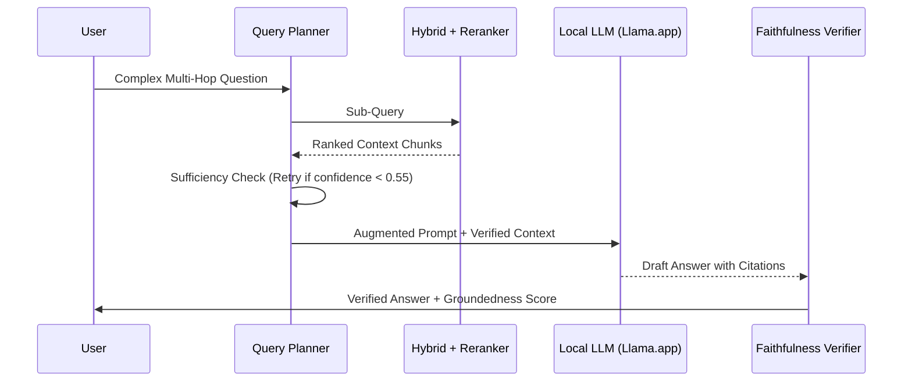
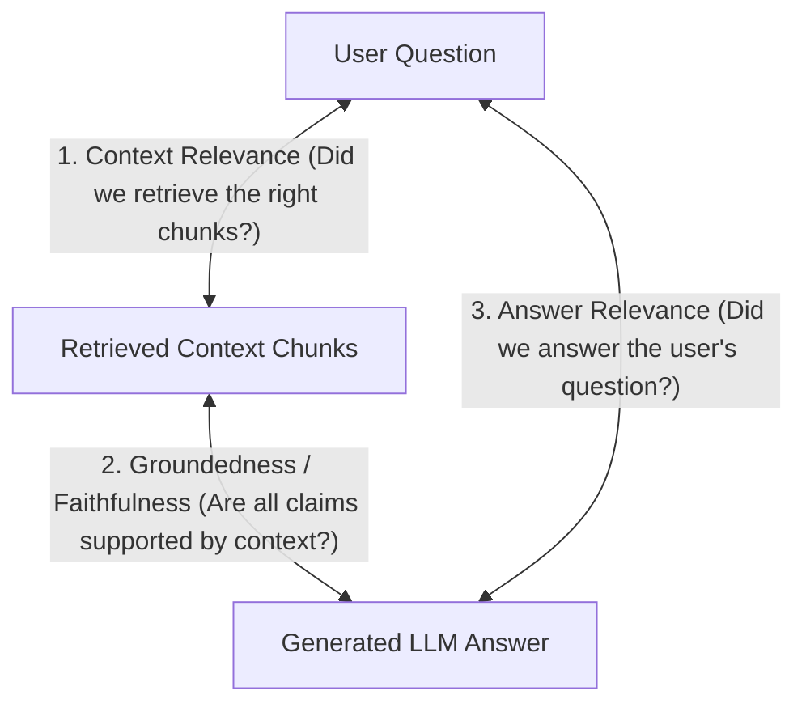
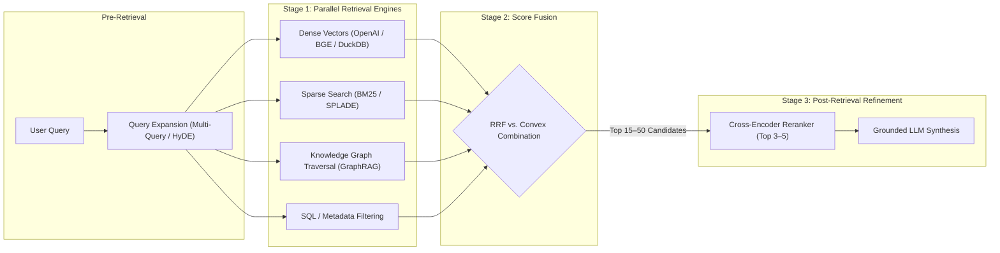

# 🦉 The Complete Beginner-to-Production RAG Reference Guide

A friendly, step-by-step reference manual for **Retrieval-Augmented Generation (RAG)**—designed to accompany the interactive **RAG Tutor** Marimo notebooks.

---

## Table of Contents
1. [The Core Idea: Why Do We Need RAG?](#1-the-core-idea-why-do-we-need-rag)
2. [How Basic RAG Works (In 50 Lines of Python)](#2-how-basic-rag-works-in-50-lines-of-python)
3. [Intuition Behind Vector Embeddings & Cosine Similarity](#3-intuition-behind-vector-embeddings--cosine-similarity)
4. [Document Chunking Strategies & Rules of Thumb](#4-document-chunking-strategies--rules-of-thumb)
5. [Persistent Vector & Full-Text Storage with DuckDB](#5-persistent-vector--full-text-storage-with-duckdb)
6. [Common Improvements for Production RAG](#6-common-improvements-for-production-rag)
   - [6.1 Hybrid Search (BM25 + Vector + Reciprocal Rank Fusion)](#61-hybrid-search-bm25--vector--reciprocal-rank-fusion)
   - [6.2 Cross-Encoder Reranking](#62-cross-encoder-reranking)
   - [6.3 Agentic RAG Workflows](#63-agentic-rag-workflows)
7. [Running Local Models on macOS with `Llama.app`](#7-running-local-models-on-macos-with-llamaapp)
8. [Evaluating Your RAG System (The RAG Triad)](#8-evaluating-your-rag-system-the-rag-triad)
9. [Advanced Graph, Hybrid & Modular RAG Architectures](#9-advanced-graph-hybrid--modular-rag-architectures)
   - [9.1 Stage 1: Parallel Retrieval Techniques](#91-stage-1-parallel-retrieval-techniques)
   - [9.2 Stage 2: Score Fusion Techniques (RRF vs. Convex Combination)](#92-stage-2-score-fusion-techniques-rrf-vs-convex-combination)
   - [9.3 Stage 3: Pre- & Post-Retrieval Refinement (Query Expansion & Reranking)](#93-stage-3-pre--post-retrieval-refinement-query-expansion--reranking)
   - [9.4 Hybrid Vector Database Ecosystem & Weight Tuning](#94-hybrid-vector-database-ecosystem--weight-tuning)
10. [Further Reading & References](#10-further-reading--references)

---

## 1. The Core Idea: Why Do We Need RAG?

Think of a Large Language Model (LLM) as a brilliant student taking a **closed-book exam**. It can write clearly and reason well using what it memorized months ago during training (**parametric memory**), but it has three unavoidable blind spots:

1. **Private Data Blindness**: It has never read your private company runbooks, local notes, or proprietary code.
2. **Knowledge Cutoffs**: It cannot know about events, releases, or updates that happened after its training finished.
3. **Hallucinations**: When asked about a specific fact it doesn't know, a closed-book LLM will often guess a fluent, plausible-sounding—but completely fabricated—answer.

### Closed-Book LLM vs. Open-Book RAG



### The Two Phases of Every RAG System

**Retrieval-Augmented Generation (RAG)** operates in two simple phases:
1. **Phase 1 — Offline Indexing**: Split documents into chunks, compute an embedding vector for each chunk, and store them in a searchable index.
2. **Phase 2 — Online Retrieval & Generation**: Embed the user's question, retrieve the top-$K$ most relevant chunks, inject them into the prompt, and generate a grounded response.



---

## 2. How Basic RAG Works (In 50 Lines of Python)

As demonstrated in Xuan-Son Nguyen's Hugging Face guide ([*Code a simple RAG from scratch*](https://huggingface.co/blog/ngxson/make-your-own-rag)), you don't need a massive framework to understand RAG. A complete in-memory RAG pipeline needs just three functions:

```python
import math


# 1. Pure-Python Cosine Similarity
def cosine_similarity(a: list[float], b: list[float]) -> float:
    dot_product = sum(x * y for x, y in zip(a, b))
    norm_a = math.sqrt(sum(x * x for x in a))
    norm_b = math.sqrt(sum(x * x for x in b))
    if norm_a == 0.0 or norm_b == 0.0:
        return 0.0
    return dot_product / (norm_a * norm_b)


# 2. In-Memory Vector Database: list of (chunk_text, embedding_vector)
VECTOR_DB: list[tuple[str, list[float]]] = []


def add_chunk_to_database(chunk: str, embed_fn) -> None:
    VECTOR_DB.append((chunk, embed_fn(chunk)))


# 3. Retrieve Top-N Most Similar Chunks
def retrieve(query: str, embed_fn, top_n: int = 3) -> list[tuple[str, float]]:
    query_vec = embed_fn(query)
    scores = [(chunk, cosine_similarity(query_vec, vec)) for chunk, vec in VECTOR_DB]
    scores.sort(key=lambda pair: pair[1], reverse=True)
    return scores[:top_n]
```

*(See [`src/rag_tutor/scratch_rag.py`](../src/rag_tutor/scratch_rag.py) and [`notebooks/01_rag_fundamentals.py`](../notebooks/01_rag_fundamentals.py) to interact with this code live!)*

---

## 3. Intuition Behind Vector Embeddings & Cosine Similarity

### What is an Embedding?
An **embedding** is a fixed-length list of floating-point numbers (for example, `128`, `384`, or `768` numbers) produced by an embedding model:

```text
"EVs convert 85% to 90% of battery energy into motion."  ──►  [ 0.41, -0.18,  0.73, ... ]
"How efficient are electric vehicle powertrains?"        ──►  [ 0.39, -0.21,  0.70, ... ]
"DuckDB SQL array syntax"                                ──►  [-0.52,  0.64, -0.11, ... ]
```

Texts with similar meanings activate similar coordinates in this high-dimensional space, even when they don't share the exact same words (*"battery energy into motion"* vs. *"electric vehicle powertrains"*).

### Why Cosine Similarity?
Given two vectors $A$ and $B$, **Cosine Similarity** measures the cosine of the angle $\theta$ between them:

$$\text{cosine\_similarity}(A, B) = \frac{A \cdot B}{\|A\| \cdot \|B\|} = \frac{\sum_{i=1}^{n} A_i B_i}{\sqrt{\sum_{i=1}^{n} A_i^2}\sqrt{\sum_{i=1}^{n} B_i^2}}$$

```text
        Vector B (Related Chunk)
          ↗
         /   Small angle θ ≈ 12°  ──►  cos(θ) ≈ +0.98 (High Match!)
        / ) θ
       +────────────► Vector A (User Query)
       |
       | 90°         Orthogonal θ = 90° ──► cos(θ) = 0.00 (Unrelated)
       ▼
     Vector C (Unrelated Topic)
```

| Score | Angle $\theta$ | Meaning |
| :--- | :--- | :--- |
| **`+1.0`** | $0^\circ$ | Identical direction — highly synonymous or directly related |
| **`0.0`** | $90^\circ$ | Orthogonal — completely unrelated topics |
| **`-1.0`** | $180^\circ$ | Opposite direction |

Because we divide by the vector lengths $\|A\|$ and $\|B\|$, a 1-sentence summary and a 4-sentence paragraph about the same topic still point in nearly the same direction!

---

## 4. Document Chunking Strategies & Rules of Thumb

Real documents aren't 1-line EV facts. Before indexing, you must split documents into **chunks** with a small **sliding overlap** so sentences near boundaries don't lose their context:

```text
Full Document:  [==================== Section 1 & Section 2 Text ====================]

Chunk #1:       [================ Chunk #1 (400 chars) ================]
                                                       |<-- Overlap -->|
Chunk #2:                                              [================ Chunk #2 (400 chars) ================]
```

| Strategy | How It Works | Best For | Pitfalls |
| :--- | :--- | :--- | :--- |
| **Line / Sentence Split** | 1 chunk per line or sentence | FAQs, CSV rows, `ev-facts.txt` | Loses multi-sentence explanations |
| **Fixed-Character Window + Overlap** | Slices every $N$ characters with $M$ characters of sliding overlap | Unstructured plain text, transcripts | Can cut tables or code blocks in half |
| **Markdown / Section-Aware** | Splits on `#`, `##`, `###` headings first; subdivides long sections with overlap | Technical docs, wikis, runbooks | Requires structured headings |

> **Beginner Rule of Thumb**: Start with **Markdown Section-Aware chunking**, a max chunk size of **300–500 characters (or ~150–300 tokens)**, and a **15%–20% sliding overlap** so context across boundaries is preserved.

---

## 5. Persistent Vector & Full-Text Storage with DuckDB

Instead of running a separate database server, **DuckDB** runs directly inside your Python process (`import duckdb`) and stores chunks, metadata, and fixed-size `FLOAT[N]` vector embeddings in a single file:

```sql
-- 1. Create a table with a fixed-size FLOAT[128] vector column
CREATE TABLE rag_chunks (
    chunk_id INTEGER PRIMARY KEY,
    doc_source VARCHAR,
    section_title VARCHAR,
    chunk_text VARCHAR,
    char_length INTEGER,
    embedding FLOAT[128]
);

-- 2. Compute exact Cosine Similarity directly in SQL
SELECT
    chunk_id,
    doc_source,
    section_title,
    chunk_text,
    array_cosine_similarity(embedding, $query_vec::FLOAT[128]) AS vector_score
FROM rag_chunks
ORDER BY vector_score DESC
LIMIT 5;
```

*(Explore this interactively in [`notebooks/02_chunking_and_duckdb.py`](../notebooks/02_chunking_and_duckdb.py). The SQL playground in [`DuckDBVectorStore`](../src/rag_tutor/duckdb_store.py) disables extension auto-install/autoload and `enable_external_access` before locking configuration, and uses DuckDB's `extract_statements` parser to enforce single read-only `SELECT` queries.)*

---

## 6. Common Improvements for Production RAG

When graduating from a prototype to a production RAG system, three architectural upgrades deliver the largest gains in retrieval accuracy and answer reliability:



### 6.1 Hybrid Search (BM25 + Vector + Reciprocal Rank Fusion)
- **The Problem**: Vector embeddings are great at conceptual synonyms (*"EV kinetic energy recovery"* $\leftrightarrow$ *"regenerative braking recovers 70% of kinetic energy"*), but terrible at exact error codes, SKUs, or function names (like `ERR-VEC-768` or `INC-APOLLO-99`).
- **The Solution**: Run **Okapi BM25** (exact keyword frequency + inverse document frequency) alongside **Vector Cosine Similarity**, then merge their ranked lists using **Reciprocal Rank Fusion (RRF)**:

$$\text{RRF\_Score}(d) = \frac{\alpha}{k + \text{rank}_{\text{vector}}(d)} + \frac{1 - \alpha}{k + \text{rank}_{\text{bm25}}(d)}$$

where $k = 60$ (`RRF-K60`) smooths out rank differences and $\alpha \in [0, 1]$ controls the balance between semantic and keyword search.



### 6.2 Cross-Encoder Reranking
- **The Problem**: Standard embedding models are **Bi-Encoders**—they compress the query and document chunk into separate vectors independently. Noisy "distractor" chunks that share general topic words often rank high without actually answering the question. Stuffing 20–50 noisy chunks into the prompt triggers the **"Lost in the Middle"** effect, degrading LLM accuracy and increasing latency.
- **The Solution (Two-Stage Retrieval `STAGE2-RERANK-15to3`)**:
  1. **Stage 1 (Fast Recall)**: Retrieve the top 15–25 candidates in milliseconds using Hybrid Search.
  2. **Stage 2 (High-Precision Rerank)**: Pass each `(query, chunk)` pair together through a **Cross-Encoder Reranker** that evaluates token-to-token cross-attention and phrase proximity, keeping only the top 3–5 passages for the LLM prompt.



### 6.3 Agentic RAG Workflows
- **The Problem**: A static `Retrieve -> Generate` pipeline fails when a user asks a multi-part question spanning multiple documents (e.g., *"What causes DuckDB error `ERR-VEC-768` and how does `STAGE2-RERANK-15to3` improve precision?"*).
- **The Solution**: Give an agentic loop control over retrieval:
  1. **Query Decomposition**: Break multi-hop questions into targeted sub-queries.
  2. **Iterative Lookup & Sufficiency Check**: Retrieve evidence for each sub-query and automatically trigger a keyword-boosted retry if confidence is low.
  3. **Response Verification (Self-Reflection)**: Audit each sentence in the generated answer against the retrieved chunks to verify faithfulness before returning it to the user.



---

## 7. Running Local Models on macOS with `Llama.app`

**RAG Tutor** connects natively to [**`Llama.app` (`ggml-org/Llama-macOS`)**](https://github.com/ggml-org/Llama-macOS), which runs an OpenAI-compatible `llama.cpp` server on macOS at **`http://localhost:9931/v1`**:

- **Inspect Installed Models**:
  ```bash
  curl http://localhost:9931/v1/models
  ```
- **Fast Non-Thinking RAG Mode vs. Thinking Mode**:
  `src/rag_tutor/llm_backend.py` supports toggling `reasoning_effort="none"` and `chat_template_kwargs={"enable_thinking": False}` so standard RAG queries answer rapidly, while allowing full reasoning when desired.
- **Loopback-Only, Prompt Isolation & Graph Filtering**:
  `LlamaMacOSClient` restricts URLs to validated loopback hosts without redirects or proxy env overrides, `build_rag_prompt` neutralizes embedded `<context>` tags while isolating chunks inside `<context>` delimiters to mitigate indirect prompt injection, and `ModularRAGPipeline` applies SQL metadata filters to Knowledge Graph triples as well as vector/BM25 chunks.
- **Zero-Friction Offline Fallback**:
  If `Llama.app` is closed or loading weights, `RAG Tutor` automatically falls back to a built-in deterministic context synthesizer so every slider, SQL query, hybrid fusion, and reranking step in the Marimo notebooks continues working without interruption.

---

## 8. Evaluating Your RAG System (The RAG Triad)

When tuning chunk sizes, $\alpha$ weights, or reranker cutoffs in Notebook 4, evaluate your pipeline across three core metrics (**The RAG Triad**):



1. **Context Relevance (Precision & Recall)**: Did the retriever bring back the exact chunks needed to answer the question, with minimal irrelevant noise?
2. **Groundedness (Faithfulness)**: Is every claim in the LLM's response verifiable from the retrieved chunks alone (zero hallucination)?
3. **Answer Relevance**: Did the final response directly address all parts of the user's original question?

---

## 9. Advanced Graph, Hybrid & Modular RAG Architectures

Traditional "Naive RAG" follows a rigid linear chain (`Query -> Single Dense Vector Search -> Top-K Prompt`). **Modular RAG** replaces this single track with composable building blocks spanning **Pre-Retrieval Query Expansion**, **Parallel Retrieval**, **Score Fusion**, and **Post-Retrieval Refinement**—which you can explore interactively in [`notebooks/05_advanced_modular_graph_rag.py`](../notebooks/05_advanced_modular_graph_rag.py) and [`src/rag_tutor/modular_graph_rag.py`](../src/rag_tutor/modular_graph_rag.py).



### 9.1 Stage 1: Parallel Retrieval Techniques

At search time, a Hybrid / Modular RAG pipeline queries multiple specialized engines simultaneously so one engine covers another's blind spots:

- **Dense + Sparse Search**: The most common production pairing. **Dense retrieval** uses neural embeddings (such as OpenAI `text-embedding-3` or `BAAI/bge`) to match semantic meaning, paraphrases, and synonyms. **Sparse retrieval** uses inverted-index keyword algorithms such as **Okapi BM25** or learned sparse models like **SPLADE** to match exact error codes, acronyms, part numbers, and serial numbers.
- **Vector + Knowledge Graph Search (`GraphRAG`)**: Pairs unstructured passage similarity with **Knowledge Graph** traversal. While the vector engine pulls descriptive chunks, the graph engine walks typed `(subject, predicate, object)` relationships across 1 to 2 hops from matched query entities to retrieve structured multi-document facts (implemented in `KnowledgeGraphStore`).
- **Vector + SQL / Metadata Filtering**: Uses structured database predicates (such as `department`, `author`, `updated_year`, or access tier) to narrow the candidate pool before or alongside vector similarity search:

```sql
-- Vector + SQL Metadata Filtering in DuckDB
SELECT chunk_id, doc_source, section_title, department, updated_year,
       array_cosine_similarity(embedding, $query_vec::FLOAT[128]) AS vector_score
FROM rag_chunks
WHERE department = 'advanced-architecture' AND updated_year >= 2026
ORDER BY vector_score DESC
LIMIT 5;
```

### 9.2 Stage 2: Score Fusion Techniques (RRF vs. Convex Combination)

Because lexical BM25 scores (unbounded positive floats like `4.85`), dense cosine scores (`[-1.0, 1.0]`), and graph hop weights live on incompatible mathematical scales, candidate lists must be fused carefully:

- **Reciprocal Rank Fusion (`RRF-K60`)**: The scale-invariant industry default. Instead of comparing raw similarity values, RRF blends each chunk's rank position across retrievers (`1 / (k + rank)`), pushing documents that rank strongly in both lists to the top without requiring score calibration.
- **Weighted Linear Combination (Convex Combination)**: Normalizes each engine's scores onto a shared `[0.0, 1.0]` interval (e.g., via Min-Max scaling) and takes a weighted sum controlled by $\alpha \in [0, 1]$:

$$\text{Convex\_Score}(d) = \alpha \cdot \hat{S}_{\text{vector}}(d) + (1 - \alpha) \cdot \hat{S}_{\text{bm25}}(d)$$

For example, $\alpha = 0.7$ computes **70% Vector Score + 30% Keyword Score**.

| Fusion Method | How It Blends | Strengths | Trade-offs |
| :--- | :--- | :--- | :--- |
| **Reciprocal Rank Fusion (`RRF`)** | Sums $\frac{\alpha}{k + r_{\text{vec}}} + \frac{1-\alpha}{k + r_{\text{bm25}}}$ | Immune to raw score outliers; zero calibration needed | Discards score magnitude gaps between Rank #1 and Rank #2 |
| **Convex Combination** | Min-Max / Z-score normalize to `[0, 1]`, then linear blend | Preserves sharp confidence spikes (e.g., exact ID match) | Sensitive to score normalization anomalies across queries |

### 9.3 Stage 3: Pre- & Post-Retrieval Refinement (Query Expansion & Reranking)

- **Query Expansion (`Multi-Query` & `HyDE`)**:
  - **Multi-Query Expansion**: Before searching, an LLM rewrites an ambiguous prompt into 3–4 complementary search variations covering different technical phrasings and merges the resulting candidate pools.
  - **HyDE (Hypothetical Document Embeddings)**: Generates a plausible hypothetical answer passage first and embeds that passage instead of the raw question, bridging the vocabulary gap between short questions and longer answer paragraphs.
- **Cross-Encoder Reranking (`Top-50 -> Top-5`)**: Once parallel retrieval and score fusion surface a broad candidate pool (top 15–50 chunks), a specialized reranking model (such as **Cohere Rerank**, `BAAI/bge-reranker`, or `ms-marco-MiniLM-L-6-v2`) evaluates every `(query, chunk)` pair with full cross-attention, discarding false positives and keeping only the top 3–5 passages for the LLM prompt.

### 9.4 Hybrid Vector Database Ecosystem & Weight Tuning

When graduating from embedded **DuckDB** to distributed production infrastructure, several vector databases support hybrid search and metadata filtering natively:

| Database | Native Hybrid Engines | Built-In Fusion | Filtering & Reranking |
| :--- | :--- | :--- | :--- |
| **DuckDB (Embedded)** | `FLOAT[N]` Cosine + `fts` BM25 + SQL | Custom SQL / Python (`RRF` or `Convex`) | Full SQL `WHERE` joins + Python Cross-Encoder |
| **Qdrant** | Named Dense + Sparse (`SPLADE` / BM25) vectors | Native `RRF` (`Prefetch` API) | HNSW payload filtering + custom rerank step |
| **Weaviate** | Dense HNSW + Inverted BM25F | `rankedFusion` (`RRF`) & `relativeScoreFusion` (`Convex`) | GraphQL metadata filters + reranker modules |
| **Pinecone** | Hybrid Dense-Sparse Indexes | Client / server alpha weighting | Metadata filter dicts + Pinecone Inference rerankers |
| **Elasticsearch / OpenSearch** | Dense `knn` + Lucene BM25 | Native `rrf` & `linear` retrievers | Inverted filter cache + Learning-to-Rank / rerank |

> **Weight-Tuning Rule of Thumb**: Use $\alpha \in [0.25, 0.40]$ when queries frequently cite exact identifiers, codes, or SKUs; $\alpha \in [0.50, 0.70]$ for balanced technical documentation; and $\alpha \in [0.75, 0.90]$ for broad paraphrased conceptual queries—always pairing broad Stage-1 recall (`Top 25–50`) with a Stage-2 Cross-Encoder reranker (`Top 3–5`).

---

## 10. Further Reading & References

1. **Xuan-Son Nguyen (`ngxson`)** — [Code a simple RAG from scratch (Hugging Face Blog)](https://huggingface.co/blog/ngxson/make-your-own-rag)
2. **LaunchDarkly** — [LLM RAG Tutorial: Retrieval-Augmented Generation Explained](https://launchdarkly.com/blog/llm-rag-tutorial/)
3. **Microsoft Azure Architecture Center** — [Design and develop a RAG solution](https://learn.microsoft.com/en-us/azure/architecture/ai-ml/guide/rag/rag-solution-design-and-evaluation-guide)
4. **Gautam Vhavle (DEV Community)** — [Building Production RAG Systems from Zero to Hero](https://dev.to/gautamvhavle/building-production-rag-systems-from-zero-to-hero-2f1i)
5. **ggml-org** — [Llama-macOS (`Llama.app`) Native Local LLM Runner](https://github.com/ggml-org/Llama-macOS)
